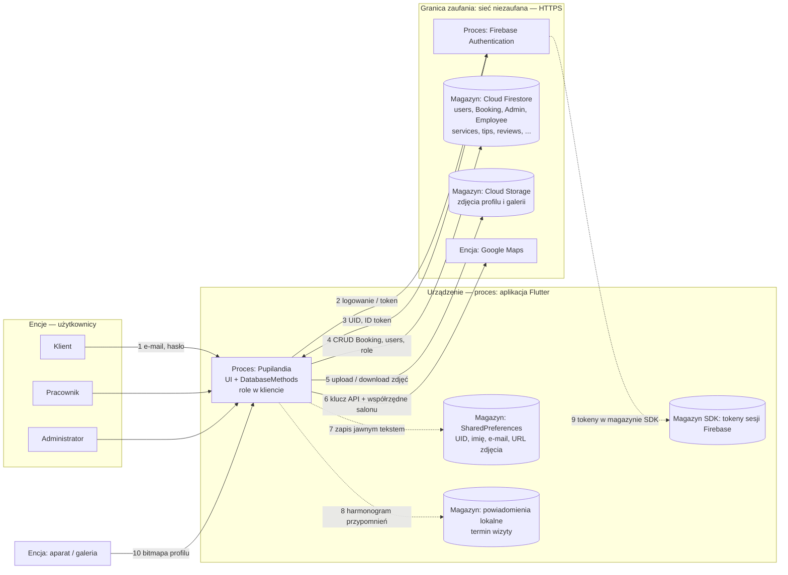

# DFD — Pupilandia (zajęcia 2)

Diagram przepływu danych v1. Każdy przepływ przez granicę zaufania (przerywana ramka) jest kandydatem na STRIDE.

Narzędzie: Markdown + Mermaid (można wyeksportować PNG z GitHub / mermaid.live). Alternatywa na później: OWASP Threat Dragon.

## Elementy

| Typ | U nas |
| --- | --- |
| Encje zewnętrzne | Klient, pracownik (groomer), administrator; Google Maps; (plan) inna aplikacja przez deep link |
| Procesy | Aplikacja Flutter; Firebase Authentication; Cloud Firestore; Cloud Storage |
| Magazyny | Firestore (kolekcje); Storage (pliki); SharedPreferences; magazyn tokenów SDK Auth; powiadomienia lokalne |
| Przepływy | HTTPS (SDK Firebase), zapis/odczyt SharedPreferences, uprawnienia kamery/galerii, intenty (plan: App Links) |
| Granice zaufania | Aplikacja ↔ sieć; aplikacja ↔ system Android; użytkownik ↔ urządzenie; kod ↔ biblioteki (pluginy Flutter / SDK) |

## Diagram

**Przerywane strzałki 7–9** = granica **aplikacja ↔ system** (schowek, backup, pliki, Keystore którego jeszcze nie używamy).

**Strzałki 2–6** = granica **aplikacja ↔ sieć**.

## Trzy przepływy do STRIDE w pierwszej kolejności

| # | Przepływ | Granica | Dane z karty projektu |
| --- | --- | --- | --- |
| DF-2/3 | Logowanie i token | aplikacja ↔ sieć | hasło, token sesji, UID — poufne |
| DF-4 | Odczyt/zapis `Booking` i kolekcji ról | aplikacja ↔ sieć | rezerwacje, e-mail, role — poufne |
| DF-7 | Zapis profilu do SharedPreferences | aplikacja ↔ system | e-mail, UID, imię, URL zdjęcia — poufne |

## Świadomie poza zakresem v1 (dopiszemy gdy powstaną funkcje)

- Deep link / App Links (granica aplikacja ↔ inne aplikacje)
- WebView z treścią zewnętrzną
- Biometria (`local_auth`)
- FCM / push (nie używamy — tylko powiadomienia lokalne)
