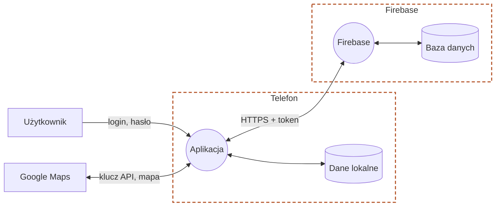

# Model zagrożeń - Pupilandia

## Diagram (DFD)
 

## Zagrożenia

| ID | Element | STRIDE | Zagrożenie | Ryzyko | Decyzja |
|----|---------|--------|------------|--------|---------|
| T01 | Baza danych | E | Klient czyta cudze rezerwacje | Wysokie | Zredukować |
| T02 | Firebase | E | Użytkownik nadaje sobie rolę admina | Wysokie | Zredukować |
| T03 | Firebase | S, D | Zgadywanie haseł | Wysokie | Przenieść |
| T04 | Aplikacja | I | Komunikaty błędów zdradzają, czy konto istnieje | Średnie | Zredukować |
| T05 | Aplikacja → Firebase | T | Rezerwacja na cudzy e-mail lub ze zmienioną ceną | Średnie | Zredukować |
| T06 | Baza danych | E, I | Pracownik widzi rezerwacje innych groomerów | Średnie | Zredukować |
| T07 | Dane lokalne | I | Dane w telefonie zapisane jawnym tekstem | Średnie | Zredukować |
| T08 | Dane lokalne | I | Token w kopii zapasowej telefonu | Średnie | Zredukować |
| T09 | Firebase | D | Fałszywe rezerwacje blokują kalendarz | Średnie | Zredukować |
| T10 | Aplikacja → Google Maps | I | Klucz Google Maps wyciągnięty z aplikacji | Średnie | Zredukować |
| T11 | Aplikacja | I | Zbędne uprawnienie lokalizacji | Średnie | Wyeliminować |
| T12 | Baza danych | R | Brak historii zmian rezerwacji | Niskie | Zredukować |
| T13 | Aplikacja ↔ Firebase | T | Podsłuch ruchu | Niskie | Zaakceptować |